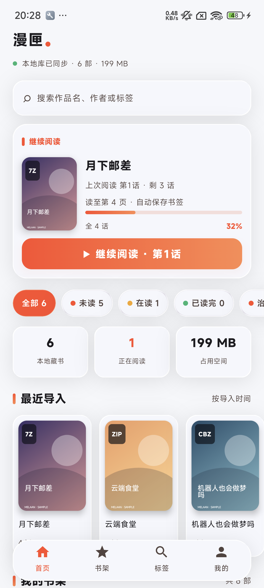

<div align="center">
  
  <h1>Melaan</h1>
  <p>Android 本地漫画与电子书阅读器 · Local comics and ebooks, read offline.</p>
  <p>
    <a href="https://github.com/LXFLGH/Melaan/releases/tag/lastRelease"></a>
    
    
  </p>
</div>

Melaan 是一款面向 **本地漫画与电子书收藏** 的 Android 阅读器。选择设备上的目录，扫描归档与 EPUB/PDF/TXT 文档、整理书架，然后离线阅读；书籍内容由你自行提供，应用不内置在线书源。

[下载仓库现有 Debug APK（可能落后于源码）](https://raw.githubusercontent.com/LXFLGH/Melaan/main/artifacts/Melaan-debug.apk) · [查看 Releases](https://github.com/LXFLGH/Melaan/releases/tag/lastRelease) · [查看源码](https://github.com/LXFLGH/Melaan) · [反馈问题](https://github.com/LXFLGH/Melaan/issues)

## 应用截图

<!-- 由 ADB 从设备截取；请勿放入含有个人漫画标题或封面的截图。 -->



## 功能

### 阅读

- 左右翻页或纵向连续滚动，支持 RTL/LTR 阅读方向。
- 双指缩放与平移、页码滑杆、音量键翻页和阅读时亮度调节。
- 横屏对开阅读、图片适配、书签、阅读进度恢复和章节自动衔接。
- 全局阅读偏好可由单本漫画覆盖。

### 电子书（1.1.0 源码功能，待完整实机验证）

- EPUB 读取 OPF 元数据和 spine 章节，用 WebView 渲染本地 XHTML/CSS/图片。
- PDF 使用系统 PdfRenderer 按页显示；TXT 支持 UTF-8/GB18030 等编码及中文章节识别。
- EPUB/TXT 默认支持跨章节无缝连续滚动与相邻章节预加载，可在阅读设置关闭；支持字号、行距、边距、夜间背景、全文搜索和命名书签。
- EPUB 2 NCX 与 EPUB 3 nav 目录标题解析；受限 WebView 加载原始 CSS/图片资源。
- PDF 支持双指缩放、平移、适宽、横屏双页与缩略图跳页；Android 15+ 支持对含文字层的 PDF 搜索。
- 文档阅读位置保存与恢复；复杂 EPUB 和超大文件仍需进一步实机兼容性、内存与安全测试。

### 书架

- 通过 Android 系统文件选择器授权一个或多个目录，递归扫描本地漫画和电子书。
- 收藏、用户书单、最近阅读历史、标签筛选和批量标签整理。
- 本地自定义标题、作者、系列（不改原文件）；按最近阅读、作者、系列、文件格式排序。
- 授权的 SAF 文件若大小与修改时间均未变化，重新扫描可复用旧章节索引。
- 重复条目可检查后移除书架记录；不会删除归档原文件。
- R18 封面屏蔽开关可将所有漫画封面统一替换为灰色；它只遮住封面，不隐藏标题或漫画正文。
- 支持导出与合并恢复本地阅读和书架数据。

## 支持格式

| 类型 | 支持范围 |
| --- | --- |
| 外层归档 | `.7z`、`.zip`、`.cbz`、`.rar`、`.cbr` |
| 本地电子书 | `.epub`、`.pdf`、`.txt`（1.1.0 源码，待实机回归） |
| 嵌套章节 | ZIP/CBZ 外层归档中的一层 ZIP/CBZ 章节归档 |
| 漫画页面 | JPEG、PNG、WebP、BMP、AVIF（Android 12 及以上） |

页面按需从归档读取并在内存中解码，不会解压漫画页到公共存储。封面缓存和最小书架索引保存在应用私有空间。RAR/CBR 的页面读取可能比 ZIP/7z 慢，尤其是大归档。

## 开始使用

1. 下载上方的当前 APK 并安装；也可以在 [GitHub Releases](https://github.com/LXFLGH/Melaan/releases/tag/lastRelease) 查看版本记录。需要 Android 12（API 31）或更新版本。
2. 打开应用，进入 **我的 → 扫描管理**，选择漫画库目录并授予读取权限。
3. 返回书架或首页打开作品；阅读进度和书签会由应用本地保存。

> 已提交源码版本为 `1.1.0`（versionCode `14`）。仓库已发布的 Debug APK/lastRelease 仍需核对及重新构建，不能仅凭文件名判断它已包含电子书功能。

## 从源码构建

需要 Android SDK、JDK，以及仓库提供的 Gradle Wrapper。在项目根目录运行：

```powershell
.\gradlew.bat :app:testDebugUnitTest :app:assembleDebug
```

生成文件：`app/build/outputs/apk/debug/app-debug.apk`

只需编译 APK 时可运行：

```powershell
.\gradlew.bat :app:assembleDebug
```

## 项目结构

- `app/` — Android 应用、阅读器和本地书架。
- `Prismal/` — Liquid Glass UI 组件。
- `doc/` — 需求合同、模块说明与验证记录。
- `preview/` — UI 预览和 README 截图。
- `artifacts/` — 仓库中附带的 Debug APK。

## 隐私与许可

Melaan 只读取用户通过系统文件选择器授权的本地目录。应用不附带漫画内容或在线内容源。漫画页面按需读取，不写入公共目录；阅读记录、标签、书单及设置保存在本机。

**项目限制：禁止商用。**本项目没有授予整体开源许可证。第三方组件依照各自许可证使用，详见 [`Prismal/LICENSE`](Prismal/LICENSE) 与 [`Junrar 许可文本`](app/src/main/res/raw/junrar_license.txt)。

请仅导入你有权存储和阅读的漫画内容。功能建议和 Bug 反馈请提交到 [GitHub Issues](https://github.com/LXFLGH/Melaan/issues)。
